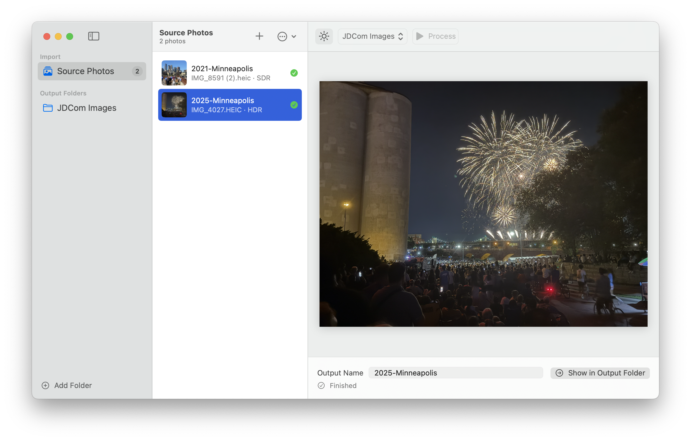
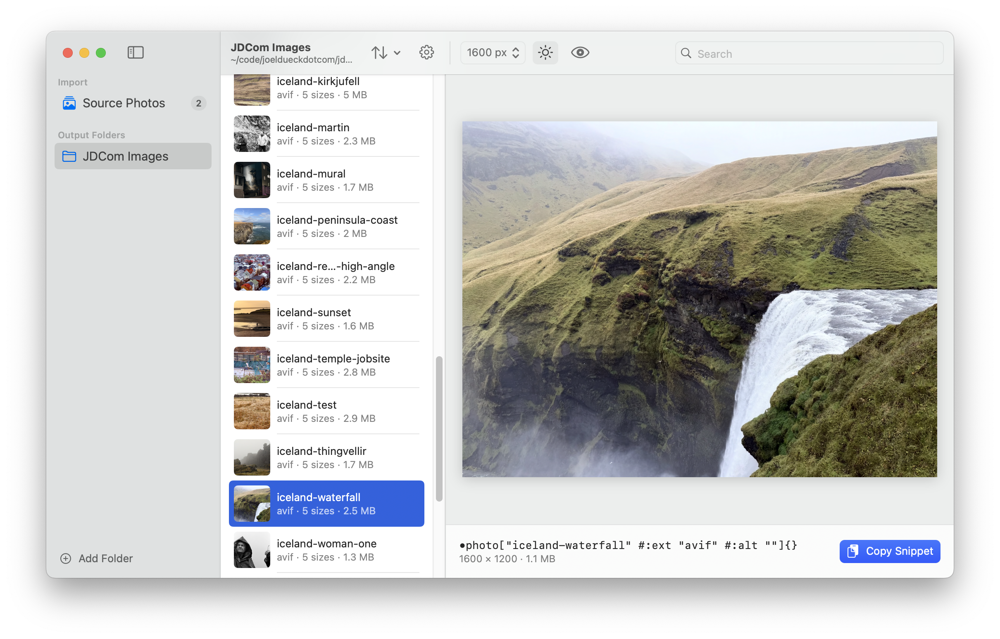
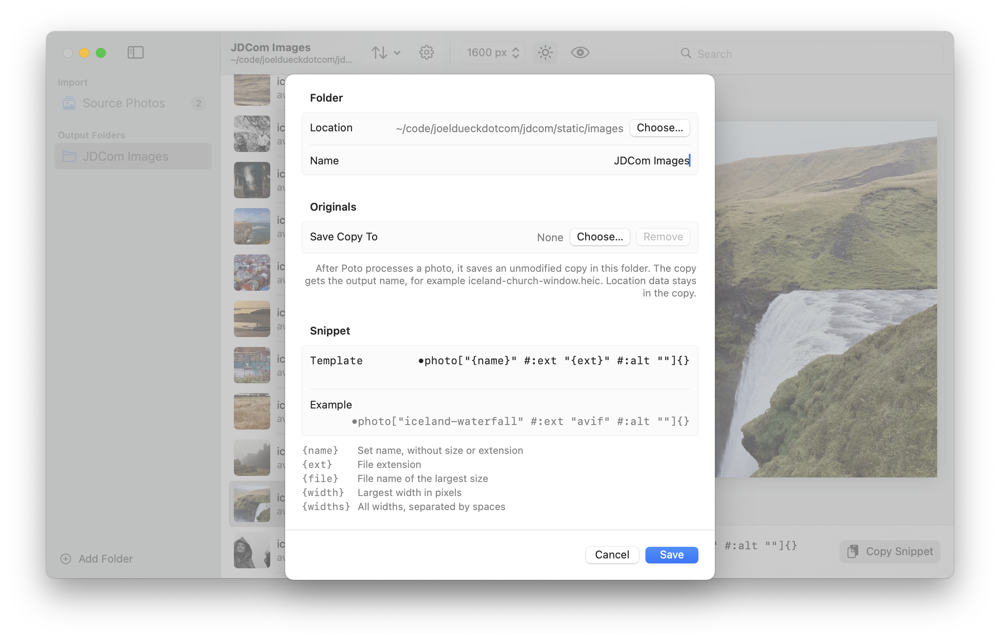

# Poto: a macOS photo preprocessor for your static site

Wrangling images is always the worst part of publishing on a static site generator, so I had the
clanker make an app that makes it easier (Level 7 on the [self-assessed AI level scale][ai]).

Give Poto a photo and it produces a set of AVIF files, `<name>-<width>.avif`, at five widths (500 to
1600 px by default), ready for a `srcset`. An original HDR HEIC from an iPhone comes out as
HDR-encoded AVIF, processed in the same manner as [this script][he]. Any other photo gets a plain
SDR encode. Camera, lens, exposure and date tags carry over to the output; all other metadata,
location included, is removed.

For each output folder you can configure a text snippet to copy to the clipboard, so you can paste
it into the source for your posts.

> [!NOTE]
> I am not offering support for this app or even recommending that anyone use it directly.
> I offer it only because you may find it useful as raw material for your own projects.

## Screenshots

Drop photos on the Source Photos list, give each one an output name, pick an output folder and
press Process.



An output folder lists every image set that Poto finds in it. Select a set to preview any of its
sizes and copy the snippet.



Each output folder has its own snippet template. A folder can also keep an unmodified copy of each
original.



## Requirements

Poto needs macOS 15 or later. It does the conversion with the same command-line tools as the
script, so install them first:

```sh
brew install libheif libavif imagemagick exiftool uv
uv tool install git+https://github.com/johncf/apple-hdr-heic.git
```

The Tools pane in Settings shows which of them Poto found.

## License

Since no part of the code had a human author, it cannot be copyrighted in the US and therefore
cannot be provided under a license.

[ai]: https://www.visidata.org/blog/2026/ai/#self-assessed-ai-level-for-contributions
[he]: https://github.com/otherjoel/heic-to-hdr-avif
